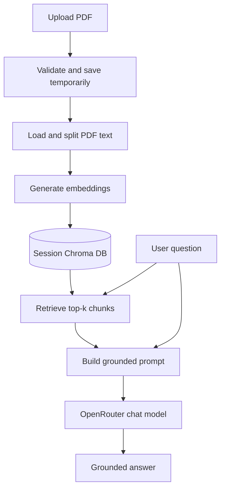

# LangChain PDF RAG Chatbot

A conversational Retrieval-Augmented Generation (RAG) app for asking questions
over uploaded PDF documents. The app parses PDF text, splits it into chunks,
stores embeddings in a local Chroma vector database, retrieves relevant context,
and generates grounded answers from the uploaded content.

## Features

- PDF ingestion with validation for empty, oversized, or non-PDF uploads.
- Recursive text chunking for semantic retrieval.
- Local Chroma vector storage with session-scoped directories.
- OpenRouter chat and embedding models through LangChain.
- Streamlit chat UI with session history.
- Content-hash based duplicate detection for repeated uploads.

## Architecture



## Tech Stack

- Python
- Streamlit
- LangChain
- OpenRouter
- ChromaDB
- PyPDF

## Getting Started

### Prerequisites

- Python 3.10 or higher
- An OpenRouter API key: <https://openrouter.ai/>

### Installation

1. Clone the repository.

```bash
git clone https://github.com/sruthiraju04/langchain-pdf-rag-chatbot.git
cd langchain-pdf-rag-chatbot
```

2. Create and activate a virtual environment.

```bash
# Windows
python -m venv venv
.\venv\Scripts\activate

# macOS/Linux
python3 -m venv venv
source venv/bin/activate
```

3. Install dependencies.

```bash
python -m pip install -r requirements.txt
```

4. Configure environment variables.

Copy `.env.template` to `.env` and add your OpenRouter API key.

```env
OPENROUTER_API_KEY=your_openrouter_api_key_here
OPENROUTER_CHAT_MODEL=openai/gpt-4o-mini
OPENROUTER_EMBEDDING_MODEL=openai/text-embedding-3-small
OPENROUTER_BASE_URL=https://openrouter.ai/api/v1
```

Optional configuration:

```env
MAX_UPLOAD_SIZE_MB=25
DEFAULT_RETRIEVAL_K=4
```

## Running the App

```bash
python -m streamlit run app.py
```

Then open <http://localhost:8501>.

## Running Tests

```bash
python -m pip install -r requirements-dev.txt
python -m pytest
```

## Project Structure

```text
.
|-- app.py                  # Streamlit UI and session workflow
|-- rag_pipeline.py         # PDF loading, chunking, retrieval, and generation
|-- file_utils.py           # Upload validation, hashing, and filename safety
|-- config.py               # Environment and app configuration
|-- requirements.txt        # Runtime dependencies
|-- requirements-dev.txt    # Test dependencies
|-- tests/                  # Starter unit tests
|-- .env.template           # Environment variable template
|-- .streamlit/config.toml  # Streamlit runtime settings
|-- .gitignore              # Local artifact exclusions
|-- LICENSE                 # MIT license
`-- README.md
```

## Limitations

- Scanned PDFs without embedded text need OCR before this app can answer from them.
- The vector database is local and intended for demos or personal projects.
- Uploaded document text is sent to the configured model provider for embeddings and answers.
- This is a learning project, not a production document security system.

## License

Distributed under the MIT License. See `LICENSE` for details.
